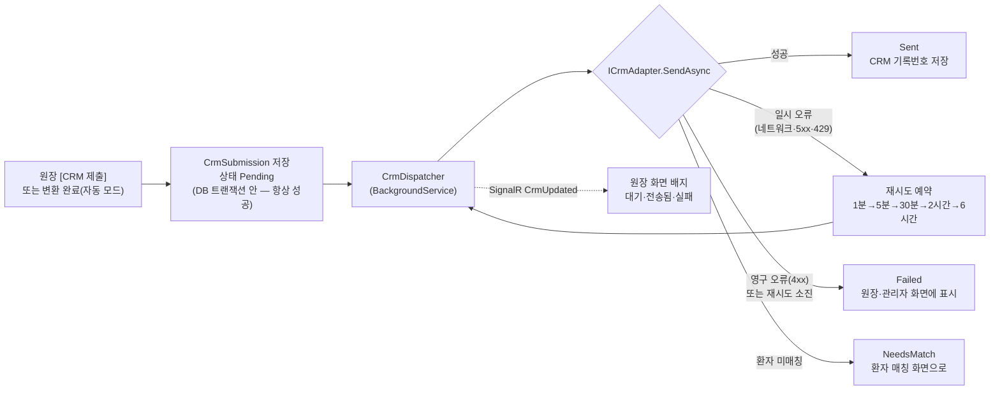
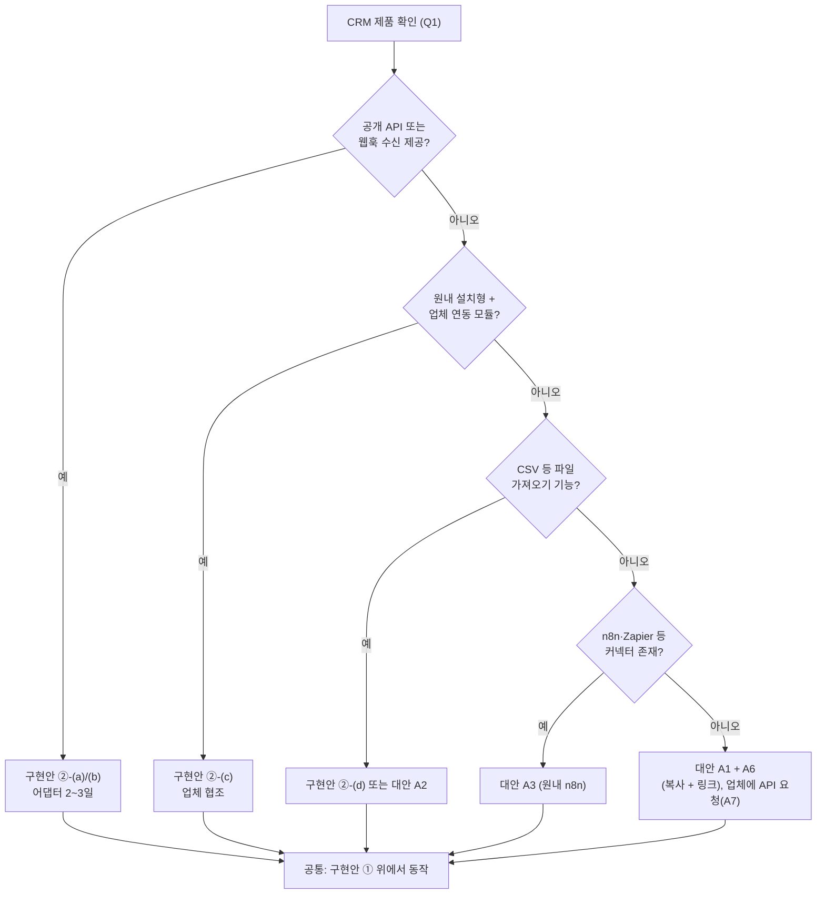

# CRM 연동 방안 — 원장 소견(녹음) 기록을 CRM에 자동 제출

> 문서 묶음: [설계 보고서](design-report.md) · [구현 보고서](implementation-report.md) · [결과 보고서](result-report.md) · **CRM 연동 방안**(이 문서)
> 작성 기준일: 2026-11-15 · 상태: **설계 완료, 코드 미구현** (CRM 정보 확인 후 착수)

## 0. 요약

- 요구: 원장이 소견을 녹음하면 Whisper가 만든 스크립트를 포함한 진료 기록이 **CRM에 자동으로 제출**되어야 합니다.
- 문제: 병원이 쓰는 **CRM이 무엇인지, 어떤 연동 수단을 제공하는지 정보가 없어** 구현안을 하나로 확정할 수 없습니다. 연동 방식은 전적으로 CRM 쪽 조건(API 유무·인증·환자 식별 방법·네트워크 위치)에 달려 있습니다.
- 대응: 작업을 세 갈래로 나눴습니다.

| 구분 | 내용 | CRM 정보 필요 | 문서 위치 |
| --- | --- | --- | --- |
| **구현 가능안 ①** CRM과 무관한 공통 기반 | 제출 대기열(Outbox) · 전송 상태 표시 · 스크립트 확인/수정 · 표준 내보내기 · 표준 웹훅 · 텍스트 복사 | 없음 — **지금 바로 구현 가능** | §3 |
| **구현 가능안 ②** CRM 유형별 어댑터 | 클라우드 API · 원내 설치형 · 파일 수신형 CRM에 맞춘 전송기 1개 | CRM 제품·API 문서·테스트 계정 | §4 |
| **대안** | 자동 연동이 불가능하거나 늦어질 때: 반자동 복사, 일괄 파일, 중계 플랫폼, RPA, GoodMoNa를 원본으로 | 일부 | §5 |

권장 진행: **①을 먼저 만들어 오늘부터 "텍스트 복사 → CRM 붙여넣기"로 운영**하고, CRM 정보가 확인되면 ②의 어댑터 하나만 추가해 자동 제출로 전환합니다. ②가 불가능한 CRM이면 §5의 대안 중 하나로 확정합니다.

## 1. 확인되지 않은 정보 (구현안을 확정하지 못한 이유)

| # | 모르는 것 | 왜 구현에 영향을 주나 |
| --- | --- | --- |
| Q1 | CRM 제품명 · 형태 (클라우드 / 원내 설치형 / 자체 개발) | 통신 방식(인터넷 HTTPS vs 내부망)과 연동 주체(업체 API vs 파일)가 갈림 |
| Q2 | 외부 연동 수단 (REST API · 웹훅 수신 · 파일 가져오기 · 없음) | 자동 제출 가능 여부 자체를 결정 |
| Q3 | 인증 방식 (API 키 · OAuth2 · IP 허용 목록 · VPN) | 키 보관·토큰 갱신·고정 IP 필요 여부 |
| Q4 | 환자 식별 키 (CRM 환자번호 · 차트번호 · 전화번호) | GoodMoNa는 이름+생년월일만 가짐 → 매칭 방법이 필요 |
| Q5 | 받는 형식 (진료 메모 텍스트 필드 · 구조화된 항목 · 첨부 파일) | 스크립트·경과·사진을 어떻게 나눠 넣을지 |
| Q6 | 사진·음성 첨부 가능 여부와 크기 제한 | 파일 전송 vs 링크만 |
| Q7 | 같은 기록 재전송·수정 처리 (중복 방지 키, 수정 API) | 원장이 스크립트를 고친 뒤 다시 보낼 때 덮어쓸지/추가할지 |
| Q8 | "자동 제출"의 의미 — 변환 즉시 vs 원장 확인 후 | 의무기록 정확성 책임 (§2.2) |
| Q9 | 호출 한도 · 테스트(샌드박스) 계정 유무 | 운영 데이터로 시험해야 하는지 |

이 질문들은 §7의 "업체 확인 질문지"로 그대로 쓸 수 있습니다.

## 2. 무엇을 · 언제 보내나

### 2.1 제출 단위와 내용

제출 단위는 **방문 1건**입니다. 녹음이 여러 개면 한 기록에 순서대로 묶습니다.

| 항목 | GoodMoNa 출처 | 비고 |
| --- | --- | --- |
| 환자 식별 | `PatientCrmLink.CrmPatientId` (신규) | 처음 한 번 매칭 후 저장 (§3.4) |
| 방문일 · 경과 · 간호사 메모 · 보고자 | `Visit` | |
| 원장 소견 | `Transcript.Text` (녹음별, 확인·수정본) | 녹음 순번(소견 1, 2…)과 길이 포함 |
| 제출자 | 로그인한 원장 (`sub`, `name`) | |
| 사진 | 사진 파일 또는 GoodMoNa 사진 링크 | CRM 첨부 가능 여부(Q6)에 따라 |
| 원본 녹음 | 보내지 않음(기본) | 필요하면 링크만. 음성은 개인정보 부담이 큼 |

표준 데이터 형식(웹훅·내보내기·어댑터 공통, 예시 값은 가짜):

```json
{
  "schema": "goodmona.visit-record/v1",
  "idempotencyKey": "visit-1024-v1",
  "version": 1,
  "patient": { "goodmonaId": 57, "crmId": "C-000123", "name": "홍길동", "birthDate": "1980-01-01" },
  "visit": {
    "id": 1024, "date": "2026-11-15", "progress": "Improved",
    "nurseMemo": "정수리 부위 밀도 증가", "reportedBy": "김간호", "reportedAt": "2026-11-15T01:20:00Z"
  },
  "opinions": [
    { "seq": 1, "durationMs": 24000, "text": "지난번보다 정수리 밀도가 좋아졌고 …", "edited": true, "model": "large-v3-turbo" }
  ],
  "photos": [ { "id": 3311, "url": "https://goodmona.hsdevs.com/api/photos/3311", "takenAt": "2026-11-15T01:12:00Z" } ],
  "submittedBy": { "id": 3, "name": "이원장" },
  "submittedAt": "2026-11-15T01:31:00Z"
}
```

### 2.2 제출 시점 — "자동"을 어디까지로 볼 것인가

| 방식 | 흐름 | 장점 | 위험 | 판단 |
| --- | --- | --- | --- | --- |
| A. 변환 완료 즉시 자동 | 녹음 → 변환 완료 → 바로 전송 | 원장 조작 0회 | **음성 인식 오류(약어·약품명·숫자)가 의무기록에 그대로 들어감**, 잘못 말한 녹음도 전송됨 | 설정으로만 허용 |
| **B. 원장 확인 후 한 번 누르기** | 녹음 → 변환 → 스크립트 확인·수정 → [CRM 제출] | 정확성 책임이 명확, 클릭 1회 | 원장이 누르는 걸 잊을 수 있음 → 미제출 목록으로 보완 | **기본값 권장** |
| C. 하루 마감 일괄 | 진료 종료 후 미제출 건을 한 번에 확인·제출 | 진료 중 방해 없음 | 기록 반영이 늦음 | B의 보완 기능 |

설정 `Crm:SubmitMode = Manual | AutoAfterTranscription`(기본 Manual). 자동 모드여도 원장이 스크립트를 고치면 새 버전으로 다시 제출합니다(§3.2).

## 3. 구현 가능안 ① — CRM과 무관한 공통 기반 (지금 바로 가능)

CRM이 무엇이든 필요하고, CRM이 정해지기 전에도 그 자체로 쓸모 있는 부분입니다.

### 3.1 전체 구조: 바로 보내지 않고 "제출 대기열"에 먼저 저장 (Outbox 패턴)



- 버튼을 누르는 순간 CRM이 꺼져 있거나 인터넷이 끊겨도 기록은 사라지지 않고, 연결이 돌아오면 자동으로 나갑니다.
- 이미 있는 구조를 그대로 따릅니다: 녹음 변환의 `TranscriptionQueue` + `TranscriptionWorker`(대기열·재시작 복구·SignalR 상태 푸시)와 같은 모양입니다.
- CRM마다 다른 부분은 `ICrmAdapter` 하나에 가둡니다. 버튼·대기열·재시도·상태 표시는 CRM과 무관합니다.

### 3.2 데이터 추가

| 엔티티 | 주요 필드 | 설명 |
| --- | --- | --- |
| `CrmSubmission` (Outbox) | `VisitId`, `Version`, `IdempotencyKey`(`visit-{id}-v{n}`, 유일), `PayloadJson`, `Status`(Pending·Sending·Sent·Failed·NeedsMatch), `Attempts`, `NextAttemptAt`, `LastError`, `ExternalId`, `SubmittedById`, `CreatedAt`, `SentAt` | 보낸 내용 그대로 보관 → "누가 언제 무엇을 보냈는지" 감사 기록 겸용 |
| `PatientCrmLink` | `PatientId`, `CrmName`, `CrmPatientId`, `ConfirmedById`, `ConfirmedAt` | 환자 매칭 결과 (CRM이 바뀌어도 이력 유지) |
| `Transcript` 확장 | `EditedText`, `ConfirmedAt`, `ConfirmedById` | **인식 원문(`Text`)은 남기고** 원장 수정본을 따로 저장 |

- 버전: 제출 후 원장이 스크립트를 고치고 다시 제출하면 `Version`이 올라가고 새 `IdempotencyKey`로 나갑니다. CRM이 수정 API를 주면 어댑터가 `ExternalId`로 갱신, 아니면 "수정본" 기록을 추가합니다.
- 녹음 삭제: 이미 `Sent`인 기록이 있는 녹음은 삭제 시 경고(이미 CRM에 들어간 내용은 GoodMoNa에서 지워도 남음).

### 3.3 서버 코드 모양

```csharp
// Crm/ICrmAdapter.cs — CRM마다 구현체 하나
public interface ICrmAdapter
{
    string Name { get; }                                   // "Webhook", "FileExport", "<업체명>" …
    Task<IReadOnlyList<CrmPatientCandidate>> FindPatientsAsync(string name, DateOnly birthDate, CancellationToken ct);
    Task<CrmSendResult> SendAsync(CrmRecord record, string idempotencyKey, CancellationToken ct);
}

public sealed record CrmSendResult(CrmSendOutcome Outcome, string? ExternalId = null, string? Error = null);
public enum CrmSendOutcome { Sent, RetryLater, Rejected, PatientNotMatched }
```

| 추가 파일 | 역할 |
| --- | --- |
| `Crm/CrmRecordBuilder.cs` | 방문·스크립트·사진을 §2.1 형식으로 조립 |
| `Crm/CrmDispatcher.cs` | `BackgroundService`. 시작 시 `Pending`·`Sending` 복구, `NextAttemptAt`이 된 건 전송, 결과에 따라 상태·재시도 예약, SignalR `CrmUpdated` |
| `Crm/Adapters/*.cs` | `NoneAdapter`(기록만), `WebhookAdapter`, `FileExportAdapter`, 이후 업체별 어댑터 |
| `Endpoints/CrmEndpoints.cs` | 아래 API |

| API (Director 권한) | 설명 |
| --- | --- |
| `GET /api/visits/{id}/crm` | 제출 이력·현재 상태 |
| `POST /api/visits/{id}/crm/submit` | 확인한 스크립트로 제출 (대기열에 넣고 202) |
| `PUT /api/notes/{id}/transcript` | 스크립트 수정·확정 |
| `POST /api/crm/submissions/{id}/retry` | 실패 건 다시 보내기 |
| `GET /api/crm/pending?date=` | 미제출·실패 목록 (하루 마감용) |
| `GET /api/patients/{id}/crm-candidates` · `PUT /api/patients/{id}/crm-link` | 환자 매칭 |

재시도 규칙: 네트워크 오류·타임아웃·5xx·408·429 → 재시도(429는 `Retry-After` 존중), 그 밖의 4xx → 즉시 `Failed`(내용 문제라 다시 보내도 같음). 5회 실패 시 `Failed` + 화면 알림.

### 3.4 환자 매칭

이름+생년월일만으로는 동명이인을 틀릴 수 있습니다. 처음 제출할 때 어댑터의 `FindPatientsAsync`로 CRM 후보를 찾고, 원장(또는 간호사)이 한 번 골라 `PatientCrmLink`에 저장합니다. 이후로는 CRM 환자번호로만 보냅니다. 후보가 정확히 1건이고 이름·생년월일·(있다면) 전화번호가 모두 같을 때만 자동 확정하는 옵션을 둘 수 있습니다. CRM에 환자 검색 API가 없으면 화면에서 CRM 환자번호를 직접 입력받습니다.

### 3.5 CRM 정보 없이도 바로 쓸 수 있는 출구 3가지

| 출구 | 동작 | 언제 쓰나 |
| --- | --- | --- |
| **텍스트 복사** | 원장 화면 [CRM용 복사] → 정해진 양식(날짜·경과·메모·소견)으로 클립보드 → CRM 화면에 붙여넣기 | 오늘부터. 어떤 CRM이든 동작 |
| **표준 내보내기** | `GET /api/crm/export?from=&to=&format=csv` (또는 `json`) — 기간별 제출 기록을 CSV(엑셀 UTF-8 BOM)·JSON으로 | CRM에 "가져오기" 기능이 있을 때, 또는 보관용 |
| **표준 웹훅** | 제출 시 설정된 주소로 §2.1 JSON을 `POST`. 헤더 `Idempotency-Key`, `X-GoodMoNa-Signature: sha256=<HMAC(본문, 공유 비밀)>` | CRM이 웹훅을 받거나, 업체·중계 플랫폼(§5)이 받아 줄 때 |

### 3.6 작업량 추정 (①)

| 작업 | 추정 |
| --- | --- |
| 엔티티·마이그레이션, Outbox·Dispatcher·재시도, SignalR 상태 | 1.5일 |
| 스크립트 확인·수정 화면, 제출 버튼·상태 배지·미제출 목록 | 1.5일 |
| 텍스트 복사 · 내보내기 · 웹훅(HMAC) 어댑터 | 1일 |
| 환자 매칭 화면 | 0.5일 |
| 통합 테스트 (CRM 꺼짐 → 재시도 → 성공, 중복 키, 4xx 즉시 실패, 서버 재시작 복구, 수정본 재제출) | 1일 |
| **합계** | **약 5.5일** |

## 4. 구현 가능안 ② — CRM 유형별 어댑터 (CRM 정보 확인 후)

①이 있으면 아래 중 **해당하는 어댑터 하나만** 추가하면 됩니다.

| CRM 유형 | 연동 방식 | 필요한 정보 | 추가 작업 추정 | 위험 |
| --- | --- | --- | --- | --- |
| **(a) 클라우드 CRM, 공개 REST API** | `HttpClient`로 HTTPS 호출. API 키 또는 OAuth2(만료 전 자동 갱신) | API 문서, 인증 정보, 테스트 계정, 환자 검색·기록 생성 엔드포인트 | 2~3일 | 호출 한도, 업체 API 변경 |
| **(b) 클라우드 CRM, 웹훅·연동 마켓 제공** | ①의 표준 웹훅을 CRM 수신 주소로. 형식 변환이 필요하면 어댑터에서 매핑 | 수신 주소·형식·서명 방식 | 1일 | 형식이 고정돼 유연성 낮음 |
| **(c) 원내 설치형 CRM/EMR, 업체 연동 모듈(API·DLL·전용 DB 뷰) 제공** | 업체가 준 방식으로 호출. 내부망 접근 필요(§6) | 연동 규격서, 업체 협조, 내부망 경로 | 3~5일 + 업체 일정 | 업체 의존, 유지보수 계약 조건 |
| **(d) 파일 가져오기만 지원하는 CRM** | `FileExportAdapter`: CRM이 읽는 형식(CSV·XML 등)으로 공유 폴더·SFTP에 파일 생성, 처리 결과 파일이 있으면 회수 | 파일 형식 명세, 가져오기 주기 | 1~2일 | 반영이 실시간이 아님, 결과 확인이 어려움 |
| (e) 병원 자체 개발 CRM | GoodMoNa 표준 웹훅을 받는 엔드포인트를 CRM 쪽에 추가하도록 협의 | CRM 개발 담당자 | GoodMoNa 측 0~1일 | 상대 개발 일정 |

어느 유형이든 공통 확인: 테스트 계정으로 가짜 환자 몇 명에게 시험 → 원장 1명이 1주일 수동 모드로 사용 → 전체 적용.

## 5. 대안 — 자동 연동이 불가능하거나 늦어질 때

| 대안 | 방법 | 자동화 | 개발량 | 유지보수 위험 | 개인정보 | 추천 상황 |
| --- | --- | --- | --- | --- | --- | --- |
| **A1. 반자동 복사·붙여넣기** | ①의 [CRM용 복사] 버튼으로 양식 텍스트를 CRM에 붙여넣기 | 낮음 (클릭 2회) | 매우 적음 | 없음 | 외부 전송 없음 | 당장, 또는 연동 수단이 전혀 없을 때 |
| **A2. 일괄 파일 내보내기 → CRM 가져오기** | 하루 1회 CSV/엑셀을 만들어 CRM의 가져오기 기능으로 반영 | 중간 | 적음 | CRM 가져오기 형식 변경 시 수정 | 파일 취급 주의 | CRM에 일괄 가져오기가 있을 때 |
| **A3. 중계 플랫폼** | GoodMoNa 표준 웹훅 → **n8n(원내 설치)** / Make / Zapier → CRM 커넥터 | 높음 | 적음(설정 위주) | 중계 플랫폼 관리 | 클라우드 중계는 위탁 문제 → **원내 n8n 권장** | CRM이 해당 플랫폼 커넥터를 가질 때 |
| A4. RPA(화면 자동 입력) | Power Automate Desktop 등으로 CRM 화면에 자동 입력 | 높음 | 중간 | **높음**: CRM 화면이 바뀌면 깨지고, 잘못된 환자에 입력될 위험 | 원내 | 비추천. 다른 길이 전혀 없고 업체가 허용할 때 한정 |
| A5. CRM DB에 직접 쓰기 | CRM 데이터베이스 테이블에 INSERT | 높음 | 중간 | **매우 높음**: 유지보수 계약 위반·데이터 손상·업데이트 시 깨짐 | 원내 | **금지** (업체 서면 동의 + 업체가 지정한 테이블·뷰만 예외) |
| **A6. GoodMoNa를 기록 원본으로, CRM엔 링크만** | 스크립트·사진은 GoodMoNa에 두고 CRM 메모에 "GoodMoNa 기록 보기" 링크(로그인 필요)만 남김 | 중간 | 적음 | 낮음 | 데이터가 한 곳에만 | CRM이 긴 텍스트·첨부를 못 받을 때, 이중 저장을 피하고 싶을 때 |
| A7. CRM 교체/추가 기능 요청 | 업체에 API·웹훅 기능 요청, 또는 API를 제공하는 CRM으로 교체 검토 | — | — | — | — | 장기 과제 |

## 6. 결정 흐름



## 7. 네트워크 · 보안 예상 문제와 해결

| 문제 | 왜 생기나 | 해결 |
| --- | --- | --- |
| CRM이 허용한 IP에서만 접속 가능 (IP 허용 목록) | GoodMoNa 서버(원내 PC)는 일반 회선이라 공인 IP가 바뀜 | 통신사 고정 IP 신청 후 등록. 또는 고정 IP가 있는 작은 중계 서버(클라우드 VM)를 거쳐 보내기 |
| 병원 방화벽이 바깥으로 나가는 연결을 막음 | 보안 장비가 허용된 사이트만 통과 | GoodMoNa는 바깥으로 HTTPS(443)만 씀 → CRM 주소 하나만 허용 목록에 추가. 들어오는 포트는 열 필요 없음 |
| 원내 설치형 CRM에 닿지 않음 | CRM 서버가 내부망에만 있음 | GoodMoNa 서버를 같은 내부망 PC에 두는 것이 가장 간단(지금 구조 그대로 Cloudflare Tunnel 사용 가능). 떨어져 있으면 Cloudflare Tunnel 사설망 연결이나 업체 VPN |
| 내부 CRM 서버의 Windows 방화벽 | CRM 서버가 해당 포트를 막음 | 해당 포트를 GoodMoNa 서버 IP에게만 열기 (전체 개방 금지) |
| 보안 장비가 HTTPS를 중간에서 풀어 봄 (SSL 검사) | 병원 방화벽이 자체 인증서로 바꿔 끼움 | 그 인증서를 서버 PC 신뢰 저장소에 설치하거나 CRM 주소를 검사 예외로 |
| 인증 토큰 만료 | OAuth 토큰은 보통 1시간 안팎 | 만료 전 자동 갱신, 갱신 실패는 관리자 알림 |
| CRM이 느리거나 멈춤, 호출 한도 초과 | 업체 서버 사정 | Outbox 재시도(간격 증가), `Retry-After` 준수, 한도에 맞춰 속도 제한 |
| 사진이 큼 | 장당 1~2MB × 여러 장 | 첨부 가능하면 긴 변 2048px로 줄여 전송, 아니면 GoodMoNa 사진 링크만(A6) |
| 개인정보·의료정보 전송 | 의료법·개인정보보호법 | 전 구간 HTTPS, 최소 항목만, 업체와 처리위탁 계약, `CrmSubmission`에 전송 기록 보관, API 키·웹훅 비밀은 설정 파일이 아닌 Windows 자격 증명 저장소(DPAPI)에, 원본 음성은 보내지 않음 |
| 음성 인식 오류가 의무기록에 들어감 | Whisper 오인식(약품명·숫자) | 기본 수동 확인 모드(§2.2), 인식 원문과 수정본 모두 보관 |

## 8. 업체 확인 질문지

1. 제품명·버전, 클라우드인가 원내 설치형인가?
2. 외부 시스템이 진료 기록(메모)을 넣을 수 있는 API·웹훅·파일 가져오기 기능이 있는가? 문서를 받을 수 있는가?
3. 인증 방식(API 키·OAuth2·IP 허용 목록·VPN)과 발급 절차는?
4. 환자 검색 API가 있는가? 환자를 식별하는 키는 무엇인가(환자번호·차트번호)?
5. 기록 한 건에 넣을 수 있는 필드와 길이 제한은? 사진·파일 첨부가 되는가(형식·크기)?
6. 같은 요청을 두 번 보냈을 때 중복을 막는 키를 지원하는가? 이미 넣은 기록을 수정하는 API가 있는가?
7. 호출 한도는? 테스트(샌드박스) 계정을 받을 수 있는가?
8. 외부 연동에 따른 비용·계약 조건(처리위탁 계약 포함)은?

## 9. 진행 순서

| 단계 | 내용 | 기간(추정) | 선행 조건 |
| --- | --- | --- | --- |
| 1 | 병원에 CRM 제품 확인, 업체에 §8 질문지 전달 | 1주 (회신 대기) | — |
| 2 | 구현안 ① 개발 → 텍스트 복사(A1)로 운영 시작 | 약 5.5일 | 없음 (1과 병행) |
| 3 | 회신에 따라 §6 결정 흐름으로 어댑터/대안 확정 | 1일 | 1 |
| 4 | 어댑터 구현 + 테스트 계정 시험 | 1~5일 | 3, 테스트 계정 |
| 5 | 원장 1명 수동 모드 1주 시범 → 자동 모드 여부 결정 → 전체 적용 | 1~2주 | 4 |
