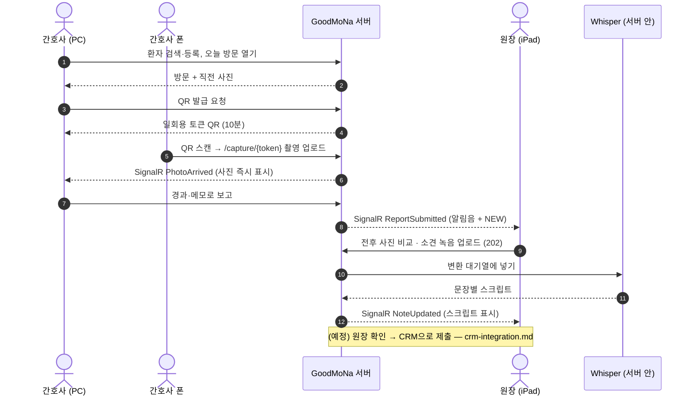
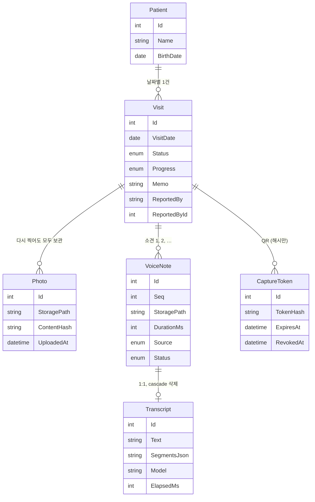

# 1번 과제 설계 보고서 — 보고 흐름 + 원장 결과 확인

> 문서 묶음: **설계 보고서**(이 문서) · [구현 보고서](implementation-report.md) · [결과 보고서](result-report.md) · [CRM 연동 방안](crm-integration.md)
> 작성 기준일: 2026-11-15 · 대상 코드: `01/` (커밋 `a1b2799` 기준)

## 1. 과제 이해

### 1.1 풀어야 할 문제

두피·모발 클리닉에서 환자가 올 때마다 간호사가 사진을 찍고 경과를 원장에게 알리는데, 지금은 사진이 개인 폰에 남고, 원장은 진료실을 오가며 확인하고, 소견은 손으로 다시 적습니다. 1번 과제는 이 흐름을 **"폰으로 찍고 보고하면, 원장 iPad에 바로 뜨고, 원장이 말한 소견이 글로 남는"** 하나의 시스템으로 묶는 것입니다.

### 1.2 요구사항 정리

| ID | 요구사항 | 사용자 | 비고 |
| --- | --- | --- | --- |
| R1 | 환자 검색·등록 | 간호사 | 동명이인 구분(생년월일) |
| R2 | 오늘 방문 생성, 직전 사진 함께 표시 | 간호사 | 환자당 하루 1건 |
| R3 | PC 화면의 QR로 폰 카메라 연결, 촬영 업로드 | 간호사 | 폰에 로그인·앱 설치 없이 |
| R4 | 폰에서 올린 사진이 PC 화면에 즉시 표시 | 간호사 | 새로고침 없이 |
| R5 | 경과(호전·유지·악화)·메모로 원장에게 보고 | 간호사 | |
| R6 | 새 보고를 원장에게 실시간 알림 | 원장 | iPad |
| R7 | 전후 사진 비교, 간호사 메모·지난 기록 확인 | 원장 | 확대·5:5 비교 |
| R8 | 원장 소견 녹음 → 자동으로 글(스크립트) 변환 → 녹음에 연결 | 원장 | 녹음 삭제 시 스크립트도 삭제 |
| R9 | 환자별 기록 재구성 (방문·사진·소견 시간순) | 원장 | |
| R10 | 이전 전산 기록 일괄 가져오기 | 관리자 | CSV + 사진 |
| R11 | **기록(녹음 스크립트 포함)을 CRM에 자동 제출** | 원장 | **CRM 정보 없음 → 별도 문서** |
| R12 | 직무별 권한 (간호사·원장·관리자) | 전원 | 2번 과제 로그인과 공유 |

비기능 요구사항:

| 구분 | 목표 |
| --- | --- |
| 개인정보 | 의료 사진·음성은 외부 서비스로 보내지 않음. 폰에는 가린 이름만. 사진 EXIF(위치) 제거 |
| 접속 | 폰 카메라·마이크 사용 → **HTTPS 필수** |
| 규모 | 병원 1곳, 동시 사용자 수 명~수십 명, 하루 방문 수십~수백 건 |
| 비용 | 월 고정비 0원에 가깝게 (클리닉 PC 1대로 운영) |
| 운영 | PC 재부팅·서버 재시작에도 자동 복구, 처리 중 녹음 유실 없음 |
| 유지보수 | 한 사람이 이어받을 수 있는 크기와 구조 |

### 1.3 범위 밖 / 미확정

- **CRM 자동 제출(R11)**: 병원이 쓰는 CRM 제품·API·인증·환자 식별 방식에 대한 정보가 없어 구현안을 하나로 확정할 수 없습니다. 이 보고서에서는 연동 지점과 데이터 구조만 설계하고, 구현 가능안과 대안은 [CRM 연동 방안](crm-integration.md)에 나눠 정리했습니다.
- 진료비·예약·처방 등 EMR 기능은 다루지 않습니다.

## 2. 전체 흐름

### 2.1 사용자 흐름



### 2.2 화면 구성

| 주소 | 화면 | 기기 | 권한 |
| --- | --- | --- | --- |
| `/` | 역할 선택 | 모두 | 누구나 |
| `/report` | 간호사 보고 | 접수·진료실 PC | 대표원장·원장·간호사 |
| `/capture/{token}` | 폰 촬영 | 간호사 폰 | QR 토큰 |
| `/director` | 원장 결과 확인·녹음 | iPad·PC | 대표원장·원장 |
| `/import` | 이전 기록 가져오기 | 서버 PC | 대표원장·관리자 (+localhost) |

### 2.3 상태 변화

```
Visit:      Draft ──(사진 1장 이상 + 경과 선택)──▶ Reported        (되돌리기 없음)
QR 토큰:    발급 ──▶ 사용 가능 ──(10분 / 새 QR 발급 / 보고 완료)──▶ 무효
VoiceNote:  Queued ──▶ Transcribing ──▶ Transcribed
                              └──────▶ Failed ──(다시 시도)──▶ Queued
```

## 3. 시스템 구조

```
폰·PC·iPad 브라우저
   │ https://goodmona.hsdevs.com
   ▼
Cloudflare (TLS 종료 · DNS)
   ▲ 터널: 서버 PC → Cloudflare 로 나가는 연결만 (포트포워딩 없음)
cloudflared (Windows 서비스 GoodMoNa01Tunnel)
   │  경로 규칙: /login·/signup·/intranet*·/api/auth/*·/.well-known/* → 02 (5002)
   │             나머지 → 01 (5001)
   ▼
GoodMoNa.Server (ASP.NET Core, Windows 서비스 GoodMoNa01) ─ 프로세스 하나
   ├─ 정적 화면       Vite 빌드 결과 (wwwroot)
   ├─ Minimal API     /api/*         ── 기능별 Endpoints/*.cs
   ├─ SignalR         /hubs/visits   ── 그룹 visit:{id}, director
   ├─ 백그라운드      TranscriptionWorker (Whisper) · ImportJobs
   ├─ 인증            02가 발급한 JWT(RS256)를 공개키로 확인 (JwtBearer)
   └─ 저장소          SQLite 파일 1개 + 사진·녹음 파일 (C:\GoodMoNa\01\data)
```

설계 원칙:

1. **프로세스 하나, 파일 하나**: API·실시간·음성 변환·가져오기를 한 프로세스에 담고, DB는 SQLite 파일 하나. 운영 대상이 하나라 고장 지점과 배포 절차가 단순합니다.
2. **오래 걸리는 일은 202 + 백그라운드**: 음성 변환·대량 가져오기는 요청 안에서 끝내지 않고 대기열에 넣은 뒤, 상태 변화를 SignalR로 보냅니다(Cloudflare 응답 대기 100초 제한도 피함).
3. **무거운 변환은 브라우저에서**: 사진 회전·EXIF 제거·축소, 녹음의 16kHz WAV 변환을 클라이언트에서 해 서버에 ffmpeg·이미지 라이브러리가 필요 없습니다.
4. **바뀌는 부분은 인터페이스 뒤로**: 음성 인식(`ISpeechToText`), 시계(`TimeProvider`), 향후 CRM(`ICrmAdapter`)은 바꿔 끼울 수 있게 두어 테스트와 교체가 쉽습니다.
5. **데이터는 리포·OneDrive 밖에**: DB가 동기화 폴더에 있으면 잠금·손상 위험이 있어 `%LOCALAPPDATA%` 또는 `C:\GoodMoNa`에 둡니다.

## 4. 기술 선택과 대안 비교

각 항목은 "고른 것 → 왜 → 다른 후보를 고르지 않은 이유" 순서입니다. 판단 기준은 1.2의 비기능 요구사항(개인정보, HTTPS, 작은 규모, 비용 0, 혼자 유지보수)입니다.

### 4.1 서버 언어·런타임: C# / .NET 10

| 후보 | 장점 | 이 과제에서의 단점 | 판단 |
| --- | --- | --- | --- |
| **C# · ASP.NET Core (.NET 10)** | Windows 서비스로 바로 등록(`AddWindowsService`), API·SignalR·BackgroundService·EF Core가 한 프레임워크 안에 있음, Whisper.net(whisper.cpp 바인딩)으로 GPU 음성 인식을 같은 프로세스에서 호출, 정적 타입 | Linux 컨테이너 생태계 자료는 Node·Python보다 적음 | **선택** |
| Node.js (Express / NestJS) | 프런트와 같은 언어(TS), 가벼움 | 음성 인식을 위해 whisper.cpp CLI나 Python을 별도 프로세스로 띄워야 함, Windows 서비스 등록에 별도 도구(nssm 등) 필요 | 탈락 |
| Python (FastAPI / Django) | Whisper 원본·faster-whisper 생태계가 가장 풍부 | 서버 PC에 Python이 없음(설치·가상환경·CUDA 관리 추가), 실시간·백그라운드 작업에 Celery/Redis 등 부품이 늘어남 | 탈락 |
| Java (Spring Boot) | 엔터프라이즈 안정성 | JVM 메모리, 설정량 대비 이 규모에 과함, 음성 인식 바인딩이 약함 | 탈락 |

### 4.2 웹 프레임워크 형태: Minimal API

| 후보 | 판단 |
| --- | --- |
| **Minimal API** — 기능별 `Endpoints/*.cs` 파일에 `Map…` 함수 | **선택.** 엔드포인트 수가 30개 안팎이라 컨트롤러 계층이 필요 없고, 라우트 그룹 단위로 권한(`RequireAuthorization`)을 걸기 쉬움 |
| MVC 컨트롤러 | 필터·모델 바인딩이 풍부하지만 이 규모에선 보일러플레이트가 더 큼 |
| Blazor Server / WASM | C# 하나로 화면까지 가능하지만 폰 촬영 페이지가 무거워지고(WASM 다운로드), Blazor Server는 상시 연결이 끊기면 화면이 멈춤 |

오류 응답은 전부 RFC 7807 ProblemDetails + 한국어 `detail`로 통일했습니다(`Endpoints/Problems.cs`).

### 4.3 실시간 전달: SignalR

| 후보 | 판단 |
| --- | --- |
| **SignalR** | **선택.** 그룹(방문별 `visit:{id}`, 원장 `director`)으로 대상만 골라 보내기, 자동 재연결, WebSocket이 막히면 SSE·롱폴링으로 자동 대체, 같은 서버 프로세스 안에서 `IHubContext`로 어디서든 푸시 |
| 순수 WebSocket | 그룹·재연결·직렬화를 직접 구현해야 함 |
| Server-Sent Events | 단방향이라 충분하긴 하지만 그룹 관리·재연결 후 재가입을 직접 만들어야 함 |
| 주기적 폴링 | 가장 단순하지만 "찍자마자 뜬다"는 체감이 떨어지고, iPad가 켜져 있는 동안 요청이 계속 쌓임 |
| Firebase / Pusher 등 외부 서비스 | 의료 데이터의 메타정보가 외부로 나가고 월 비용·계정 관리가 생김 |

### 4.4 데이터베이스: SQLite + EF Core

| 후보 | 판단 |
| --- | --- |
| **SQLite (파일 1개) + EF Core 10** | **선택.** 별도 DB 서비스 설치·계정·포트가 없음, 백업 = 파일 복사, 병원 1곳 규모(쓰기 동시성 낮음)에 충분, 마이그레이션은 서버 시작 시 자동 적용 |
| PostgreSQL / MySQL | 동시 쓰기·복제에 강하지만 DB 서비스 운영(설치·업데이트·백업 스케줄)이 추가됨 |
| SQL Server Express | Windows 친화적이지만 설치가 무겁고 DB 크기 10GB 제한 |
| 클라우드 DB (Supabase 등) | 환자 데이터가 외부 저장소로 나감, 인터넷이 끊기면 원내 업무도 멈춤 |

EF Core를 쓴 이유: 엔티티·관계(cascade 삭제 포함)를 코드로 두고 마이그레이션으로 스키마 변경 이력을 남길 수 있으며, 나중에 PostgreSQL로 옮길 때 공급자만 바꾸면 됩니다. 사진·녹음 파일은 DB에 넣지 않고 데이터 폴더에 두고 상대 경로만 저장합니다(DB 크기·백업 시간 관리).

### 4.5 음성 → 글: Whisper.net (로컬, large-v3-turbo, Vulkan GPU)

| 후보 | 비용 | 개인정보 | 한국어 품질 | 판단 |
| --- | --- | --- | --- | --- |
| **Whisper.net + ggml-large-v3-turbo (서버 PC에서 직접)** | 0원 | 음성이 PC 밖으로 안 나감 | 좋음, 의료 용어는 프롬프트로 보정 | **선택** |
| OpenAI Whisper API / GPT-4o 전사 | 분당 과금 | 외부 전송 → 위탁 계약·동의 필요 | 좋음 | 탈락 (개인정보) |
| Naver CLOVA Speech / Google STT / Azure Speech | 분당 과금 | 외부 전송 | 좋음(CLOVA는 한국어 강점) | 탈락 (개인정보·비용). 단 GPU가 없는 환경이면 대안 |
| faster-whisper (Python) | 0원 | 로컬 | 같음 | Python 런타임·CUDA 관리가 추가돼 탈락 |
| 브라우저 Web Speech API | 0원 | 브라우저 업체 서버로 전송 | 기기마다 다름, iPad Safari 제약 | 탈락 |

- 측정치: 24초 녹음 → 약 1.7초(Vulkan GPU). 서버 시작 시 모델을 미리 올려(예열) 첫 변환 13초 → 약 1초.
- GPU가 없으면 CPU로 자동 대체(느리지만 동작). 모델 파일이 없으면 서버는 뜨고 녹음만 `Failed`로 남아, 파일을 넣고 "다시 시도"하면 됩니다.
- 변환은 한 번에 하나씩(대기열) — GPU를 한 작업이 독점해야 가장 빠르고, 원장 한두 명 규모에서는 대기 시간이 문제 되지 않습니다.

### 4.6 화면: Vite + TypeScript (프레임워크 없음)

| 후보 | 판단 |
| --- | --- |
| **Vite + TypeScript, 페이지별 진입점** | **선택.** 화면 5개, 상태가 단순해 프레임워크 없이 충분. 번들이 작아 폰 촬영 페이지가 빠르게 열림. 빌드 결과를 서버 `wwwroot`로 바로 출력 |
| React / Vue / Svelte | 화면이 커지면 유리하지만 지금 규모에선 의존성·빌드 설정만 늘어남. 원장 화면(610줄)이 더 커지면 도입 검토 |
| 서버 렌더링(Razor Pages) | 실시간 갱신·카메라·녹음 등 클라이언트 동작이 많아 결국 JS가 대부분 |
| 네이티브 앱 (iOS/Android) | 설치·스토어 심사·기기 관리 부담. 브라우저로 카메라·마이크가 충분히 동작 |

디자인은 자체 CSS(`web/src/shared/base.css`)의 토큰만 씁니다: 무채색 + 강조색 한 개, 그림자·둥근 모서리·그라데이션 없음, Pretendard 글꼴. 경과(호전·유지·악화)는 색만이 아니라 모양으로도 구분합니다(색약 고려).

### 4.7 폰 연결 방식: 일회용 QR 토큰

| 후보 | 판단 |
| --- | --- |
| **PC에 QR → 폰이 스캔 → 로그인 없이 그 방문에만 사진 업로드** | **선택.** 간호사 개인 폰에 로그인 정보를 남기지 않음, 스캔 한 번이면 끝. 토큰 범위 = 방문 1건·10분·새 QR 발급 시 이전 것 무효·보고 후 무효 |
| 폰에서 직원 로그인 | 개인 폰에 진료 시스템 세션이 남고, 매번 환자를 다시 골라야 함 |
| 병원 공용 태블릿 앱 | 기기 구매·관리 필요, 사진 품질은 폰보다 나을 것 없음 |
| PC 웹캠 / USB 현미경 | 두피 근접 촬영에 위치 조정이 불편. 장비가 있으면 같은 업로드 API로 추가 가능 |

토큰은 256비트 난수이고 DB에는 SHA-256 해시만 둡니다(DB가 유출돼도 살아 있는 QR을 만들 수 없음). 폰 화면에는 가린 이름(김\*수)만 보냅니다.

### 4.8 공개·HTTPS: 서버 PC + Cloudflare Tunnel

| 후보 | 월 비용 | 판단 |
| --- | --- | --- |
| **원내(개인) PC 24시간 + Cloudflare Tunnel** | 0원(도메인 비용만) | **선택.** 인증서·포트포워딩·고정 IP 불필요, 바깥으로 나가는 연결만 사용. GPU가 있는 PC라 Whisper도 같은 곳에서 |
| Oracle Cloud 무료 VM + Caddy | 0원 | 처음 검토안. GPU가 없어 Whisper가 느리고, 환자 데이터가 클라우드로 나감 |
| Azure App Service / AWS | 수만 원~ | GPU 인스턴스는 비쌈, 이 규모에 과함 |
| 공유기 포트포워딩 + Let's Encrypt | 0원 | 병원 공유기 설정 권한·유동 IP·외부 공격 표면 문제 |

단점과 대응: PC 한 대가 단일 장애 지점입니다 → Windows 서비스 자동 시작·5초 뒤 재시작, 녹음 대기열 재시작 복구로 완화. 데이터 백업은 아직 수동(결과 보고서 한계 항목).

### 4.9 로그인·권한: 2번 과제(인트라넷)가 발급한 JWT

| 후보 | 판단 |
| --- | --- |
| **02 인트라넷이 RS256 JWT 출입증 발급, 01은 공개키(JWKS)로 서명만 확인** | **선택.** 직원 DB는 02 한 곳에만, 01은 매 요청 02에 묻지 않음. 같은 주소라 쿠키 하나로 양쪽 로그인. 출입증 15분, 퇴사·직무 변경이 늦어도 15분 안에 반영 |
| 01 자체 로그인(쿠키 세션) | 01·02에 직원 정보가 두 벌 생김 |
| 외부 IdP (Entra ID, Keycloak, Auth0) | 표준적이지만 병원 규모에 운영 대상이 하나 더 늘어남. 직원 수가 늘면 02를 IdP로 바꾸는 길은 열려 있음(OIDC 호환 JWKS 사용) |

### 4.10 테스트: 실제 HTTP + SQLite 통합 테스트

| 후보 | 판단 |
| --- | --- |
| **xUnit + WebApplicationFactory (실제 서버 파이프라인·실제 SQLite)** | **선택.** 이 시스템의 버그는 대부분 경계(권한, 상태 전이, 동시성, 파일-DB 일관성)에서 생김. 시계·STT만 가짜로 바꿔 QR 만료·변환 중 삭제 경합까지 재현 |
| 서비스 단위 테스트 + Mock DB | 빠르지만 EF·SQLite·미들웨어 동작을 검증하지 못함 |
| 브라우저 E2E (Playwright) | 카메라·마이크 자동화가 까다롭고 느림. 화면 흐름은 수동 시나리오로 확인 |

## 5. 데이터 설계



| 결정 | 이유 |
| --- | --- |
| 환자 유일 = 이름 + 생년월일 | 원내 환자번호 체계가 정해지지 않아 현실적인 최소 키. CRM 연동 시 CRM 환자번호를 따로 저장(설계) |
| 방문 유일 = 환자 + 날짜 | 같은 날 여러 번 열어도 같은 방문. 하루 2회 내원은 드묾 |
| 사진은 덮어쓰지 않고 모두 보관 | 다시 찍은 이유를 나중에 확인할 수 있게. 화면은 최신 1장 |
| `Transcript.SegmentsJson`에 문장별 시작·끝 ms | 스크립트 문장을 누르면 그 위치부터 재생 |
| 시각은 UTC, "오늘"은 `Asia/Seoul` | 서버 시간대와 무관하게 동작, 테스트에서 시계 교체 |
| enum은 DB·JSON 모두 문자열 | DB를 직접 열어도 읽힘, 값 순서 변경에 안전 |
| `Photo.ContentHash`(SHA-256) | 이전 기록 가져오기를 다시 돌려도 같은 사진이 두 번 안 들어감 |
| `Visit.ReportedById` | 보고자를 로그인한 직원번호로 남김(이름은 당시 이름 그대로) |

## 6. API 설계

| 기능 | 경로 | 권한 |
| --- | --- | --- |
| 환자 | `GET/POST /api/patients`, `POST /api/patients/{id}/visits/today`, `GET /api/patients/{id}/history` | Clinical / history는 Director |
| 방문 · 보고 | `GET /api/visits/{id}`, `POST /api/visits/{id}/capture-tokens`, `PUT /api/visits/{id}/report` | Clinical |
| 폰 촬영 | `GET /api/capture/{token}`, `POST /api/capture/{token}/photo` | QR 토큰 |
| 사진 | `GET /api/photos/{id}` (`Cache-Control: private`) | Clinical |
| 원장 | `GET /api/director/reports?date=` | Director |
| 녹음 | `GET/POST /api/visits/{id}/notes`, `GET /api/notes/{id}/audio`(Range), `DELETE /api/notes/{id}`, `POST /api/notes/{id}/retry` | Director |
| 가져오기 | `/api/import/template.csv · files · files/{경로} · preview · run · status` | ImportAdmin + 서버 PC |
| 실시간 | `/hubs/visits` → `PhotoArrived`, `VisitReported`, `ReportSubmitted`, `NoteUpdated`, `NoteDeleted` | Clinical (director 그룹은 원장만) |
| (예정) CRM | `GET /api/visits/{id}/crm`, `POST /api/visits/{id}/crm/submit`, `POST /api/crm/submissions/{id}/retry` | Director — [CRM 연동 방안](crm-integration.md) |

상태 코드 규칙: 검증 실패 400, 로그인 없음 401, 직무 불일치 403, 없음 404, 상태 충돌(이미 보고됨 등) 409, QR 만료 410, 크기 초과 413, 형식 불일치 415, 비동기 접수 202.

## 7. 보안 설계

| 위협 | 대응 |
| --- | --- |
| 비직원 접근 | 02 로그인(승인제) + 직무별 정책. 화면은 `PageGate`, API는 라우트 그룹 `RequireAuthorization` |
| QR 유출·재사용 | 256비트·10분·방문 1건 한정, 해시만 저장, 새 QR/보고 시 즉시 무효 |
| 폰 화면 엿보기 | 가린 이름만 전달 |
| 사진 위치 정보 | 브라우저에서 다시 그려 EXIF 제거 |
| 경로 조작(가져오기 파일) | `DataPaths.Resolve`가 데이터 폴더 밖 경로 거부, 파일 시그니처 검사 |
| 대량 가져오기 외부 노출 | 기본 localhost 전용, Cloudflare 경유(`Cf-Connecting-IP`)면 403 |
| 음성 데이터 외부 유출 | 음성 인식을 서버 PC 안에서만 수행 |
| 비밀값 유출 | 터널 자격 증명·서명 키는 리포 밖, 공개 리포에 커밋 금지 |

## 8. CRM 연동 설계 요약

R11(녹음 → CRM 자동 제출)은 CRM 정보가 없어 **연동 지점만 고정**했습니다.

- 제출 단위: 방문 1건 = 경과·간호사 메모·원장 소견 스크립트(녹음별)·사진 링크.
- 제출 시점: 녹음 변환 완료 즉시 자동 제출이 아니라, **원장이 스크립트를 확인한 뒤 [기록 제출]** 을 기본으로 권장(음성 인식 오류가 의무기록에 그대로 들어가는 것을 방지). 설정으로 자동 제출 전환 가능하게.
- 구조: `CrmOutbox` 테이블에 먼저 저장 → 백그라운드 전송기 → `ICrmAdapter` 구현체가 CRM별 차이를 흡수. CRM이 꺼져 있어도 기록이 사라지지 않고 재시도.
- CRM 정보 없이도 지금 만들 수 있는 것(Outbox, 상태 표시, 표준 웹훅/파일 내보내기, 텍스트 복사)과 CRM이 정해져야 하는 것(어댑터), 자동 연동이 불가능할 때의 대안을 [CRM 연동 방안](crm-integration.md)에서 구분했습니다.
