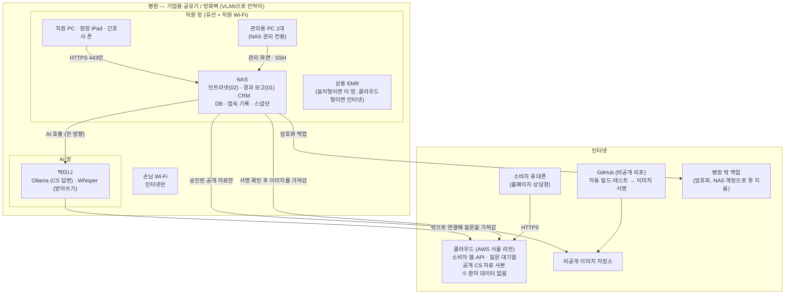
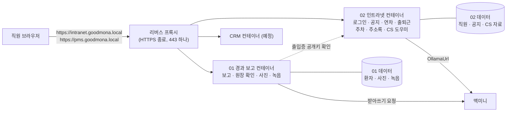
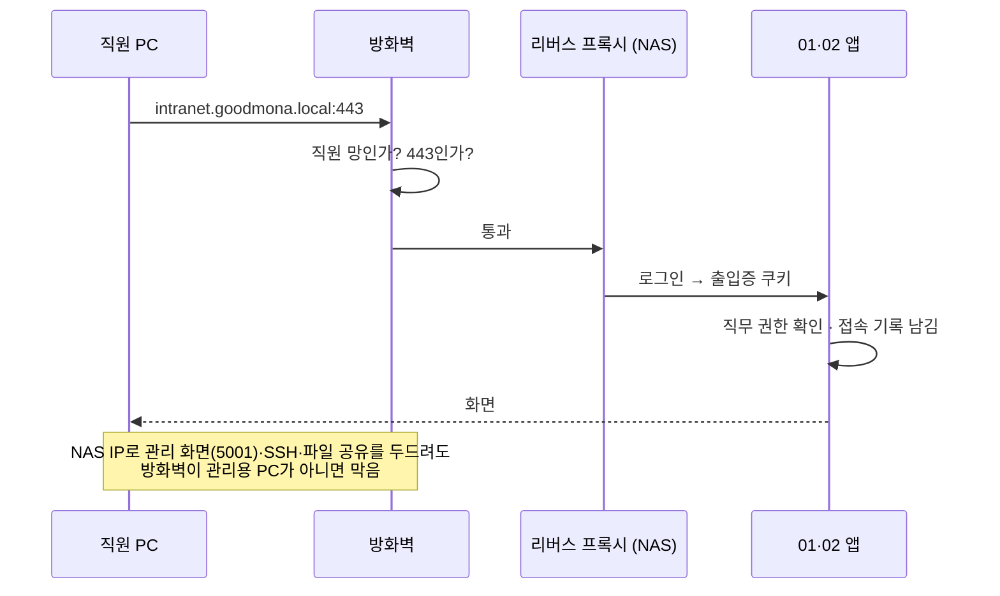
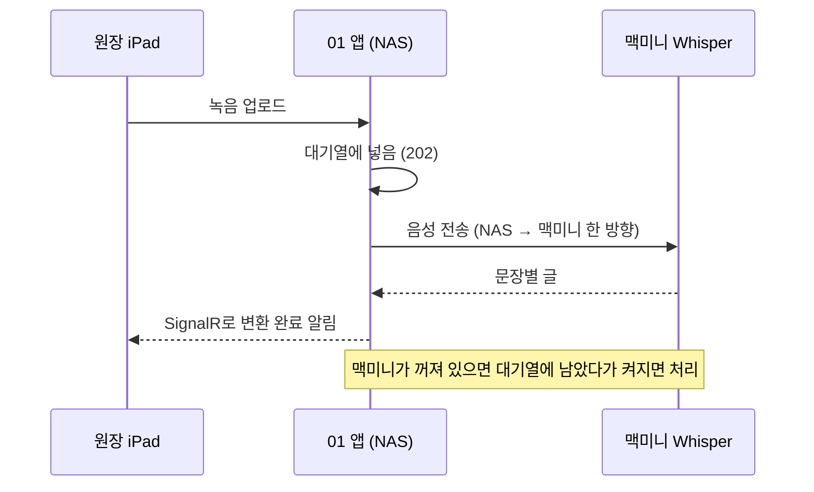
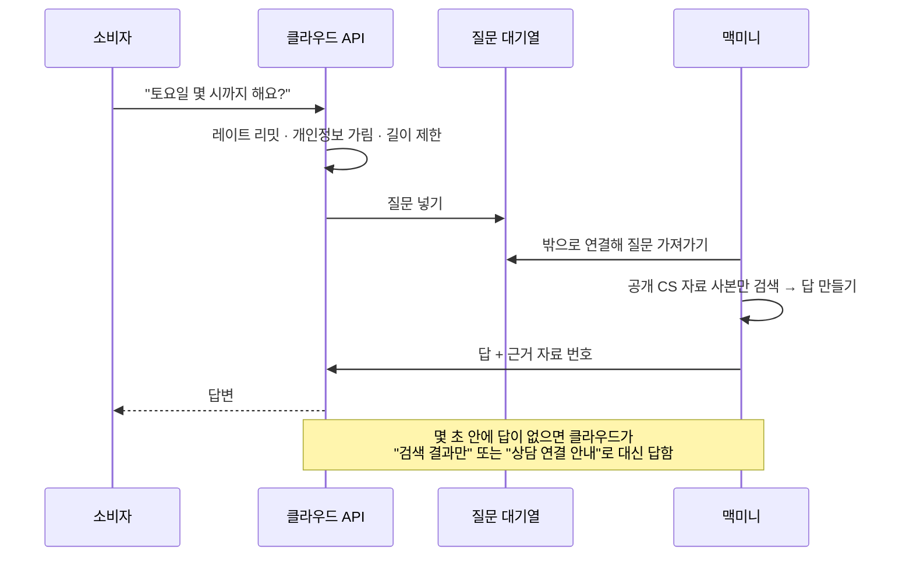
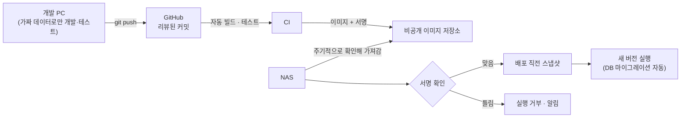
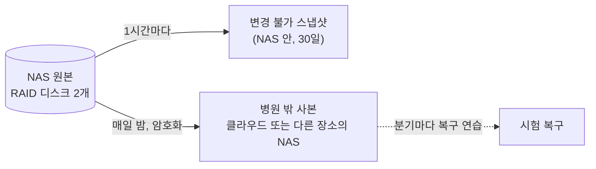

# 1·2번 과제 운영 구현 설계안 — NAS · 맥미니 · 클라우드

> 함께 보는 문서: [서버·인프라 대안 비교](infrastructure-options.md)(왜 이 구성을 골랐는지) · [시스템 설계](architecture.md)(지금 코드 구조)
> 작성 기준일: 2026-11-16 · 상태: **설계안, 미구현** (지금 운영은 서버 PC 한 대 + Cloudflare 터널)

## 0. 한 장 요약

지금 1번(경과 보고)과 2번(인트라넷 + CS 도우미)은 **개인 PC 한 대**에서 돌아갑니다. 과제 시연에는 충분하지만, 실제 병원 운영에서는 디스크 고장, 백업 없음, 정전, 윈도우 업데이트 재부팅 때문에 위험합니다. 이 문서는 **실제 운영으로 옮길 때의 구성**을 설명합니다.

| 구분 | 지금 (과제 시연) | 운영안 (이 문서) |
| --- | --- | --- |
| 서비스·DB | 개인 PC, 윈도우 서비스 2개 | **NAS**, Docker 컨테이너 |
| AI (CS 답변, 녹음 받아쓰기) | 같은 PC의 GPU | **맥미니** (AI 전용, 별도 네트워크 구역) |
| 소비자 상담 챗봇 | 없음 | **클라우드(AWS 등)**, 환자 데이터 없음 |
| 직원 접속 | 인터넷 어디서나 (터널) | **병원 직원 망에서만**, 밖에서는 VPN |
| 진료기록 (EMR) | 없음 | **상용 EMR 권장**, 우리는 주변 시스템만 (§9) |
| 배포 | 관리자 PowerShell로 PC에 직접 | **GitHub → 자동 빌드·서명 → NAS가 가져감** |
| 백업 | 없음 | 변경 불가 스냅샷 + 병원 밖 암호화 백업 |

핵심 원칙은 세 가지입니다.

1. **환자 데이터는 병원 직원 망 안에만** 둡니다. 밖으로 나가는 건 암호화된 백업과 "고객 공개"로 승인한 CS 자료뿐입니다.
2. **외부 입력을 받는 기계(맥미니, 클라우드)는 환자 데이터에 닿지 못합니다.** 통신은 한 방향으로만 엽니다.
3. **뚫리지 않게 + 빨리 알아채기 + 되살리기**를 모두 갖춥니다. 랜섬웨어 대비의 핵심은 마지막 "되살리기"입니다.

## 1. 전체 구성도

화살표는 **연결을 시작하는 쪽**입니다. 병원 방화벽은 바깥에서 들어오는 연결을 하나도 열지 않습니다. 맥미니와 NAS가 필요한 곳으로 **나가서** 가져옵니다.

## 2. 장비별 역할

| 장비 | 하는 일 | 하지 않는 일 | 고장 나면 |
| --- | --- | --- | --- |
| **NAS** (x86, 메모리 8GB 이상, 디스크 2개 이상 RAID) | 01·02·CRM 웹앱, DB, 사진·녹음 파일, 접속 기록, 스냅샷 | AI 계산(CPU가 약함), 인터넷에 직접 노출 | 업무 정지. 디스크 하나 고장은 RAID로 계속 동작. 본체 고장은 디스크를 같은 회사 NAS로 옮기거나 백업으로 복구 |
| **맥미니** | CS 답변(Ollama), 원장 소견 받아쓰기(Whisper), 소비자 챗봇 답변 | NAS 관리, 환자 DB 접근, 데이터 보관 | **AI만 빠지고 업무는 계속**. CS 도우미는 검색 결과만, 녹음은 받아쓰기 대기열에 쌓였다가 복구 후 처리 |
| **관리용 PC** | NAS 관리 화면 접속 (2단계 인증) | 메일, 웹서핑, 업무 | 다른 PC를 관리용으로 등록 |
| **클라우드** | 소비자 상담창과 API, 질문 대기열 | 환자 데이터 보관 | 소비자 챗봇만 멈춤 |
| **UPS** | 정전 시 NAS를 안전하게 종료 | | |

## 3. NAS 안의 서비스 (Docker)

| 컨테이너 | 지금 코드 | 데이터 (NAS 공유 폴더, 스냅샷 대상) | 비고 |
| --- | --- | --- | --- |
| 리버스 프록시 | 새로 추가 (Caddy 또는 NAS 내장 프록시) | 인증서 | 지금 Cloudflare 터널이 하던 "경로별 분배"를 맡음 |
| 02 인트라넷 | `02/src/GoodMoNa02.Server` | `02/data` (SQLite, `keys/signing-key.pem`, `appsettings.local.json`) | 로그인 출입증 발급처. 서명 키와 설정은 이미지에 넣지 않음 |
| 01 경과 보고 | `01/src/GoodMoNa.Server` | `01/data` (SQLite, 사진, 녹음) | 환자 데이터. 별도 DB 파일, 별도 폴더 |
| CRM | 미구현 ([CRM 연동 방안](../01/docs/crm-integration.md)) | 별도 | 상용 CRM이면 컨테이너 대신 연동 어댑터 |
| 백업 작업 | NAS 기본 기능 | | 스냅샷, 병원 밖 복제 |

지켜야 할 것:
- **DB는 컨테이너 안에서만 보입니다.** 직원 PC나 개발 PC에서 DB 파일과 포트에 닿을 수 없습니다.
- **SQLite 파일은 NAS 로컬 디스크에 둡니다.** 네트워크 공유 폴더 너머에서 SQLite를 열면 파일 잠금 문제로 DB가 깨질 수 있어, "맥미니에서 앱, NAS에 DB"처럼 나누지 않습니다.
- 01과 02의 데이터를 다른 폴더, 다른 DB로 나눕니다. 인트라넷 쪽이 뚫려도 환자 데이터 DB는 열 수 없게 합니다.

## 4. 주요 흐름

### 4.1 직원 업무 (병원 안)

"웹 주소로만 접속"은 습관이 아니라 **방화벽 규칙으로 강제**합니다(§5).

### 4.2 원장 소견 받아쓰기 (01)

지금은 01 서버 안에서 Whisper가 돌지만, NAS CPU로는 느리므로 **맥미니로 옮깁니다**. 01에는 이미 `ISpeechToText` 인터페이스가 있어서, 맥미니에 요청하는 구현을 하나 추가하면 됩니다.

### 4.3 CS 도우미 (02, 직원용)

설정 `App:Assistant:OllamaUrl`만 맥미니 주소로 바꾸면 됩니다(지금 기본값 `http://localhost:11434`). 근거는 승인된 자료만, 자동 정리는 제안만 만들고 반영은 관리자가 하는 원칙은 그대로입니다.

### 4.4 소비자 상담 챗봇 (새로 만듦)

- 클라우드와 맥미니가 보는 자료는 인트라넷 CS 자료 중 **"고객 공개"로 표시하고 승인한 것**의 사본뿐입니다. NAS가 한 방향으로 보냅니다.
- 소비자 쪽 AI에는 **환자 데이터에 닿는 도구를 절대 주지 않습니다.** 나중에 "예약 가능 시간 확인" 같은 도구(MCP 등)를 붙여도 공개 정보만 다룹니다.
- 소비자가 입력한 질문도 직원 질문처럼 **못 찾은 질문 → 자동 정리 제안**으로 이어집니다.

### 4.5 배포

- **개발 PC는 NAS에 접속하지 않습니다.** 방화벽에서 개발 PC → NAS를 완전히 막을 수 있습니다.
- 배포 권한은 앱 DB의 계정이 아니라 **저장소 계정 + 서명 키**로 확인합니다. 이미지를 올릴 수 있으면 NAS를 장악한 것과 같기 때문에, 그 문지기를 앱 안에 두지 않습니다.
- 이미지마다 버전 번호를 붙이고 이전 버전을 남깁니다. 문제가 생기면 **이전 이미지 + 배포 직전 스냅샷**으로 되돌립니다.
- 지금 리포는 과제 제출용으로 공개입니다. 실제 운영에서는 비공개 리포와 비공개 저장소를 씁니다.

## 5. 네트워크 규칙 (방화벽 표)

| 출발 | 도착 | 허용 | 이유 |
| --- | --- | --- | --- |
| 직원 망 | NAS 443 | ✅ | 웹앱 접속, 유일한 문 |
| 직원 망 | NAS 그 밖의 포트 (관리 화면, SSH, 파일 공유) | ✕ | 감염된 직원 PC가 두드리지 못하게 |
| 관리용 PC | NAS 관리 화면 · SSH | ✅ (2단계 인증) | NAS 관리 |
| NAS | 맥미니 AI 포트 | ✅ | CS 답변, 받아쓰기 |
| 맥미니 | 직원 망 전체 | ✕ | 소비자 입력을 받는 기계가 환자 데이터에 닿지 못하게 |
| 맥미니 | 클라우드 대기열 | ✅ (나가는 연결만) | 소비자 질문 가져오기 |
| NAS | 이미지 저장소, 백업 목적지, OS 업데이트 | ✅ (나가는 연결만) | 배포, 백업, 업데이트 |
| NAS | 그 밖의 인터넷 | ✕ | 악성코드가 밖으로 연결하지 못하게 |
| 인터넷 | 병원 안 어디든 | ✕ | 포트 포워딩, UPnP, NAS 원격 접속 기능 모두 끔 |
| 손님 Wi-Fi | 병원 안 어디든 | ✕ | 인터넷만 |
| 직원 휴대폰 (병원 밖) | 직원 망 | VPN으로만 | 집에서 연차 신청 등이 필요하면 |

**결정할 것**: 내부망 전용으로 바꾸면 직원이 집에서 연차 신청이나 공지 확인을 못 합니다. ① 공지·연차 같은 일반 인트라넷만 지금처럼 밖에서도 열고 2단계 인증을 붙이거나, ② 전부 내부 전용으로 두고 VPN으로만 들어오게 합니다. 환자 데이터 화면(01, CRM)은 어느 쪽이든 내부 전용입니다.

## 6. 보안 3단계

| 단계 | 할 일 | 막거나 줄이는 것 |
| --- | --- | --- |
| **어렵게 만들기** | 방화벽 표(§5) · DB 비노출 · 앱별 DB 분리 · 환자 화면 2단계 인증과 자동 로그아웃 · 직원 PC 백신/EDR과 자동 업데이트 · 원격 지원 프로그램은 필요할 때만 · NAS 디스크 암호화 · 서명된 이미지만 실행 | 외부 침입, 감염 PC의 확산, 도난, 악성 배포 |
| **빨리 알아채기** | 접속 기록(누가 언제 어떤 환자 기록을 봤나)을 **NAS 밖**의 지울 수 없는 곳으로도 보냄 · 알림: 로그인 실패 반복, 업무 시간 외 접속, 대량 열람·내보내기 | 몰래 오래 머무는 침입, 내부자 유출 |
| **되살리기** | 변경 불가 스냅샷(정해진 기간 동안 관리자도 못 지움) · NAS 관리자 계정으로 못 지우는 병원 밖 백업 · 분기마다 실제 복구 연습 | **랜섬웨어**, 실수로 삭제, 잘못된 배포 |

랜섬웨어는 대부분 **이미 안에 있는 감염된 직원 PC**로 시작합니다. 방화벽과 로그인은 첫 번째 벽일 뿐이고, 마지막 방어선은 "어제 상태로 돌아갈 수 있느냐"입니다.

## 7. 데이터와 백업

**3-2-1 원칙**: 사본 3개(원본, 스냅샷, 병원 밖), 매체 2종류, 1개는 병원 밖. RAID는 디스크 고장 대비일 뿐 백업이 아닙니다. 랜섬웨어가 암호화한 파일도 RAID는 두 디스크에 그대로 복사합니다.

병원 밖 사본을 클라우드에 둘 때는 **병원에서 암호화한 뒤** 보냅니다. 클라우드 업체는 암호화된 덩어리만 보관합니다.

## 8. 지금 코드에서 바뀌는 것

| 작업 | 대상 | 크기 | 비고 |
| --- | --- | --- | --- |
| Docker 포장 | 01, 02 각각 Dockerfile + 전체 docker-compose | 중 | 윈도우 서비스 배포(`install-all.ps1`)를 대체. 같은 이미지로 NAS든 클라우드든 옮길 수 있음 |
| 리버스 프록시 설정 | 새로 | 소 | 지금 터널의 경로 분배(`/intranet*` → 02, 나머지 → 01)를 그대로 옮김 |
| AI 주소 분리 | 02 설정 | 소 | `App:Assistant:OllamaUrl`을 맥미니 주소로. 코드 변경 없음 |
| 원격 받아쓰기 | 01 `ISpeechToText` 구현 추가 + 맥미니 Whisper 작은 서버 | 중 | 맥미니가 꺼지면 대기열에 남김 (지금 재시작 재처리 로직 활용) |
| 접근 정책 | 01·02 | 소 | 환자 데이터 API는 직원 망 IP에서만. 출퇴근 "병원 네트워크" 확인은 그대로 |
| 접속 기록 | 01 (환자 열람·내보내기), 02 | 중 | 누가·언제·어떤 환자·무엇을. 밖으로 보내는 기록 전송 포함 |
| 2단계 인증 | 02 로그인 | 중 | 환자 데이터 화면에 필수 |
| 고객 공개 구분 | 02 CS 자료 | 소 | 자료마다 "고객 공개" 표시, 승인된 공개 자료만 내보내기 |
| 소비자 API | 새 프로젝트 (클라우드) | 대 | 대기열, 레이트 리밋, 개인정보 가림, 프롬프트 인젝션 방어 |
| CI·서명·가져가기 배포 | GitHub Actions + 저장소 + NAS 갱신 도구 | 중 | |

## 9. EMR과 CRM은 어떻게

**권장: 진료기록(EMR)은 상용 제품을 쓰고, 우리는 그 주변만 만듭니다.**

- 진료기록은 의료법상 법적 기록이고, 처방전·건강보험 청구까지 하려면 심평원 검사를 통과한 청구 프로그램이 필요합니다. 직접 만들고 유지하는 비용이 상용 EMR 구독료보다 훨씬 큽니다.
- 클라우드 EMR(예: 닥터팔레트, AWS 기반)도 2016년 의료법 시행규칙 개정과 복지부 고시 이후 허용된 방식입니다. 자세한 비교와 근거는 [대안 비교 §6](infrastructure-options.md#6-emr-전자차트-만들까-살까)에 있습니다.
- 우리 차별점은 EMR에 없는 것들입니다: **경과 보고와 원장 확인(01), 굿모나 전용 CS 지식과 자동 정리(02), 소비자 상담 챗봇, 병원 맞춤 CRM**. EMR과는 환자 번호로만 연결합니다([CRM 연동 방안](../01/docs/crm-integration.md)과 같은 방향).

**EMR까지 직접 만든다면** 위 구성(NAS, 내부망, 접속 기록, 변경 불가 백업)에 더해 다음이 필요합니다: 진료기록 수정 이력 보존(지우지 않고 버전으로), 전자서명, 처방·청구 연동, 복지부 「전자의무기록의 관리·보존에 필요한 시설과 장비에 관한 기준」 충족 확인, 필요하면 EMR 인증. 법률 자문이 먼저입니다.

## 10. 단계별 진행

| 단계 | 할 일 | 멈추는 시간 | 되돌리기 |
| --- | --- | --- | --- |
| 0 | **지금 PC 데이터 백업부터** (`C:\GoodMoNa\01\data`, `02\data`를 외부로) | 없음 | |
| 1 | Docker 포장, 개발 PC에서 컨테이너로 01·02 실행 확인 | 없음 | |
| 2 | NAS 구매·설치, RAID, 스냅샷, 병원 밖 백업, UPS | 없음 | |
| 3 | NAS로 이전: 데이터 복사 → 컨테이너 실행 → 터널 대상을 NAS로 전환 | 짧음 (데이터 복사 동안) | 터널을 다시 PC로 |
| 4 | 맥미니 설치: Ollama, Whisper 서버. 01·02가 맥미니를 부르도록 설정 | 없음 | 설정을 되돌림 |
| 5 | 네트워크 분리: 기업용 공유기, VLAN, 방화벽 표 적용, 직원 망 전용 전환(또는 VPN) | 짧음 | 공유기 설정 백업 |
| 6 | CI·서명·가져가기 배포 | 없음 | 수동 배포 병행 |
| 7 | 접속 기록 외부 전송, 알림, 2단계 인증 | 없음 | |
| 8 | 소비자 챗봇 (클라우드 API + 맥미니 연결 + 공개 자료 구분) | 없음 | 기능 끔 |
| 9 | 첫 복구 연습 | 없음 | |

1~3단계는 **지금 서비스를 그대로 옮기는 일**이라 위험이 적습니다. 8단계는 그 위에 새로 쌓는 일입니다.

## 11. 병원과 정해야 할 것

| 질문 | 왜 필요한가 |
| --- | --- |
| 직원이 병원 밖에서 인트라넷을 써야 하나? | 내부 전용 vs VPN vs 일반 기능만 외부 허용 (§5) |
| 지금 쓰는 EMR·CRM 제품과 연동 수단은? | 직접 만들 범위가 정해짐 (§9) |
| 01 경과 기록이 법적 진료기록에 해당하나? | 보관·수정 이력 기준이 달라짐. 법률 확인 |
| 병원 밖 백업 위치 (클라우드 / 대표원장 집 NAS) | 개인정보 처리 위탁 계약 여부 |
| 소비자 챗봇에 공개할 자료 범위와 표현 (가격, 효과) | 의료광고 표현 제한, 법률 검토 |
| 유지보수 담당 (업데이트, 백업 확인, 복구 연습) | 장비보다 사람이 더 자주 빠짐 |
