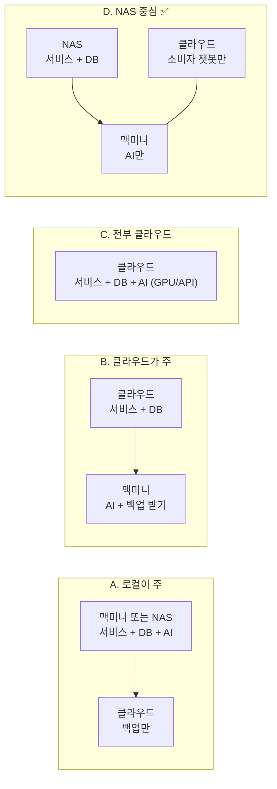
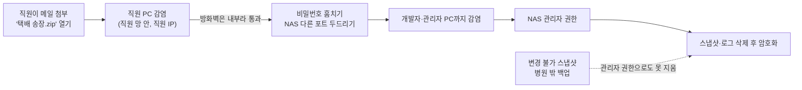

# 서버·인프라 대안 비교 — 클라우드 · 맥미니 · NAS · EMR · CRM

> 함께 보는 문서: [1·2번 과제 운영 구현 설계안](implementation-plan.md)(이 비교로 고른 구성) · [시스템 설계](architecture.md)(지금 코드 구조)
> 작성 기준일: 2026-11-16 · 법령·제품 정보는 아래 출처 기준이며, 도입 전 공식 자료와 법률 자문으로 다시 확인해야 합니다.

## 0. 한눈에 결론

| 질문 | 결론 | 한 줄 이유 |
| --- | --- | --- |
| 서비스와 DB는 어디에? | **NAS** (클라우드도 가능) | 데이터를 잃지 않는 기능(RAID, 스냅샷, 백업)이 기본으로 들어 있음 |
| AI는 어디서? | **맥미니** (병원 안, 별도 네트워크 구역) | GPU 계산은 로컬이 싸고, 질문이 밖으로 나가지 않음. 꺼져도 업무는 계속 |
| 소비자 챗봇은? | **클라우드** | 24시간 열려 있어야 하고, 병원 회선·정전과 무관해야 함 |
| 맥미니가 NAS를 관리? | **안 됨** | 외부 입력을 받는 기계가 환자 데이터 관리 권한을 가지면 챗봇이 뚫릴 때 환자 데이터도 뚫림 |
| 진료기록(EMR)은? | **상용 제품** (설치형 또는 클라우드) | 법적 기록·청구 요건을 직접 맞추는 비용이 너무 큼 |
| CRM은? | **상용이 있으면 연동, 없으면 직접** | 병원 맞춤 흐름이 차별점이 될 수 있음 |
| 인트라넷(공지·연차 등)은? | 실제 운영이면 **SaaS 그룹웨어도 검토** | 과제는 직접 개발이 맞지만, 일반 업무는 구독이 더 싸고 안정적 |
| 보안은 IP 제한이면 충분? | **아님** | 랜섬웨어는 이미 안에 있는 감염 PC로 시작. 되살리기(백업)가 핵심 |
| 배포는? | **CI가 빌드·서명, NAS가 가져감** | 개발 PC가 감염돼도 운영에 악성 이미지가 들어가기 어려움 |

## 1. 왜 이 문서가 필요한가

지금 01·02는 **개인 PC 한 대**(윈도우 11)를 24시간 켜 두고 Cloudflare 터널로 공개합니다. 과제 시연에는 충분하지만 실제 병원에서는 다음이 문제입니다.

| 위험 | 지금 상태 | 일어나면 |
| --- | --- | --- |
| 디스크 고장 | 디스크 1개 | 환자 사진·녹음·직원 데이터 전부 사라짐 |
| 백업 | **없음** | 랜섬웨어·실수 삭제를 되돌릴 방법 없음 |
| 정전·회선 장애 | UPS 없음 | 전부 멈춤, 갑자기 꺼지며 DB 손상 가능 |
| 윈도우 업데이트 | 개인용 OS | 밤사이 재부팅, 로그인해야 켜지는 앱(Ollama) |
| 24시간 공개 서비스 | 없음 | 소비자 챗봇을 열면 위 장애가 곧 서비스 중단 |

그래서 "어디에 무엇을 둘지"를 정해야 하고, 그 선택지가 많아 한곳에 비교해 둡니다.

## 2. 용어 쉽게

| 용어 | 뜻 |
| --- | --- |
| 서버 | 다른 기기에 서비스를 제공하는 컴퓨터. **역할의 이름**이라 PC도, 맥미니도, NAS도 서버가 될 수 있음 |
| NAS | 디스크를 여러 개 꽂는 **저장 중심 서버**. 모니터 없이 다른 PC의 브라우저로 관리. Docker로 앱도 돌림 |
| 클라우드 | AWS·네이버클라우드 같은 회사의 데이터센터 서버를 빌려 쓰는 것 |
| 온프레미스 | 서버를 회사(병원) 안에 직접 두는 것 |
| RAID | 디스크 여러 개를 묶어 하나가 고장 나도 계속 동작하게 함. **백업은 아님** |
| 스냅샷 | 특정 시점 상태를 저장해 그때로 되돌리는 기능. "변경 불가 스냅샷"은 정해진 기간 동안 관리자도 못 지움 |
| 3-2-1 백업 | 사본 3개, 매체 2종류, 1개는 다른 장소 |
| VLAN | 공유기 하나로 네트워크를 여러 칸으로 나누는 것 (직원 망, AI 망, 손님 Wi-Fi) |
| 터널 | 안에서 밖으로 연결을 열어 두고 그 길로 요청을 받는 방식. 공유기 포트를 열지 않음 |
| Docker | 앱을 실행 환경째 묶은 "이미지". 같은 이미지를 어디서든 똑같이 실행 |
| CI | 코드를 올리면 자동으로 빌드·테스트하는 서비스 (GitHub Actions 등) |
| EMR | 전자의무기록(전자차트). 진료기록·처방·청구 |
| CRM | 고객(환자) 관계 관리. 상담·예약·재방문 관리 |

## 3. 서버를 어디에 둘까 — 장비별 비교

| 항목 | 지금 개인 PC | 맥미니 | NAS | 클라우드 |
| --- | --- | --- | --- | --- |
| 데이터 보호 (디스크 고장) | ✕ 디스크 1개 | ✕ 내장 SSD 1개, 교체 불가 | ✅ RAID | ✅ 업체가 이중화 |
| 되돌리기 (스냅샷) | ✕ | △ Time Machine (DB에는 부족) | ✅ 기본 기능 | ✅ 기본 기능 |
| 병원 밖 백업 | ✕ 직접 구성 | △ 직접 구성 | ✅ 기본 기능 | ✅ 다른 지역 복제 |
| 24시간 운영 적합성 | △ 개인용 OS | △ 개인용 OS | ✅ 서버 전용 | ✅ |
| 정전·회선 장애 | ✕ 멈춤 | ✕ 멈춤 | △ UPS로 안전 종료, 그래도 멈춤 | ✅ 영향 없음 |
| AI 계산 (GPU) | ✅ 지금 쓰는 중 | ✅ 통합 메모리로 로컬 모델 적합 | ✕ CPU 약함, GPU 없음 | △ GPU 서버는 매달 비쌈 |
| 초기 비용 | 없음 | 중 | 중 (본체 + 디스크) | 없음 |
| 매달 비용 | 전기 | 전기 | 전기 | 사용량만큼 |
| 데이터 위치 | 병원 안 | 병원 안 | 병원 안 | 업체 데이터센터 (국내 리전 선택) |
| 관리 방법 | 직접 | 직접 | 브라우저 관리 화면 | 업체 콘솔 |
| **어울리는 역할** | 과제 시연 | **AI 전용** | **서비스 + 데이터 + 백업** | **24시간 공개 서비스**, 또는 전부 |

### 서버와 NAS는 같은 개념인가?

NAS도 서버의 한 종류입니다. 일반 서버는 범용 컴퓨터이고, NAS는 **저장과 백업에 특화된 서버**입니다. 그래서 NAS에 Docker로 인트라넷을 올리면 "저장 기능이 강한 작은 서버"를 쓰는 셈입니다. NAS는 모니터를 연결하지 않고, 같은 망의 PC 브라우저로 관리 화면(시놀로지 DSM, QNAP QTS 등)에 들어가 설정합니다.

### 맥미니는 NAS보다 부족한가?

**저장은 부족하고 계산은 훨씬 낫습니다.** 맥미니 내장 SSD는 하나뿐이고 메인보드에 붙어 있어 고장 나면 본체째 문제가 됩니다. 그렇다고 "맥미니에서 앱, NAS 공유 폴더에 DB"로 나누면 안 됩니다. SQLite를 네트워크 공유 폴더 너머에서 쓰면 파일 잠금 문제로 DB가 깨질 수 있습니다. **서비스와 DB는 같은 상자에, AI만 따로**가 원칙입니다.

## 4. 조합안 비교

| 안 | 구성 | 장점 | 단점 | 어울리는 경우 |
| --- | --- | --- | --- | --- |
| A. 로컬이 주 | 병원 안 장비 하나에 전부, 클라우드는 백업 | 가장 쌈 | 가장 잦은 장애(정전, 회선)가 곧 전체 중단. 장비 하나가 고장 나면 AI까지 같이 멈춤 | 직원만 쓰고 소비자 서비스가 없을 때 |
| B. 클라우드가 주 | 클라우드에 서비스·DB, 맥미니는 AI와 백업 | 장애가 잦은 쪽(병원)이 멈춰도 AI만 빠짐. 직원이 어디서나 접속 | 매달 비용, 개인정보 처리 위탁 계약 필요 | 직원 외부 접속이 많고 24시간 서비스가 중요할 때 |
| C. 전부 클라우드 | AI도 클라우드 GPU 또는 Claude API | 운영이 가장 편함 | GPU 서버는 비쌈. API를 쓰면 질문이 외부로 나감 | 트래픽이 커져 로컬 AI로 감당이 안 될 때 |
| **D. NAS 중심 (채택)** | NAS에 서비스·DB, 맥미니에 AI, 클라우드에 소비자 챗봇 | 환자 데이터는 병원 안에. 디스크 고장·랜섬웨어 대비가 기본 기능. AI와 공개 서비스를 나눠 위험을 분리 | 병원 정전·회선 장애 때 직원 서비스 멈춤. 장비 관리 담당자가 필요 | **환자 데이터를 병원 안에 두고 싶고, 소비자 챗봇도 열고 싶을 때** |

### 무엇이 멈추면 무엇이 멈추나

| 장애 | A | B | C | D |
| --- | --- | --- | --- | --- |
| 병원 정전·회선 장애 | 전부 | AI만 (검색 결과로 대체) | 없음 | 직원 서비스 + AI. **소비자 챗봇은 검색 결과로 계속** |
| 맥미니 고장 | 전부 (맥미니가 주인 경우) | AI만 | 해당 없음 | AI만 (CS는 검색 결과, 녹음은 대기열에 쌓임) |
| NAS 고장 | 전부 (NAS가 주인 경우) | 해당 없음 | 해당 없음 | 직원 서비스. 디스크를 같은 회사 NAS로 옮기거나 백업으로 복구 |
| 클라우드 장애 | 백업만 | 전부 | 전부 | 소비자 챗봇만 |

## 5. AI를 어디서 돌릴까

| 선택지 | 속도·품질 | 비용 | 질문이 밖으로? | 판단 |
| --- | --- | --- | --- | --- |
| 지금 PC의 GPU (Ollama qwen3:4b) | 0.2~0.7초, 승인 자료 근거 답 10/10 (2026-11-15 측정) | 전기 | 안 나감 | 과제 시연용으로 운영 중 |
| **맥미니 (Ollama)** | 메모리를 넉넉히 사면 더 큰 모델 가능 | 초기 구매 | 안 나감 | **운영안** |
| NAS | 수십 초 이상 | | 안 나감 | ✕ 실사용 불가 |
| Claude API | 가장 높은 품질 | 사용량만큼 | **나감** (가린 질문 + 찾은 자료 4건) | 대안. 이미 설정으로 전환 가능 |
| 클라우드 GPU 서버 | 높음 | 매달 큼 | 클라우드 안 | 소비자 트래픽이 커지면 검토 |

**파인튜닝은 필요 없습니다.** 지금 방식(승인된 자료 검색 → 그 자료만 근거로 답, RAG)에 자동 정리 고리(정정 → FAQ 초안, 못 찾은 질문 → 표현 추가 제안, 홈페이지 변경 감지)가 "계속 배우는" 역할을 합니다. 파인튜닝은 말투를 맞추고 싶을 때의 선택 사항입니다.

## 6. EMR (전자차트): 만들까, 살까

### 클라우드 EMR은 어떻게 가능한가

예전에는 전자의무기록을 병원 안에만 보관해야 한다고 해석했습니다. **2016년 2월 의료법 시행규칙 제16조 개정**으로 병원 밖 보관이 허용됐고, **2016년 8월부터 복지부 고시 「전자의무기록의 관리·보존에 필요한 시설과 장비에 관한 기준」**이 시행됐습니다.

| 고시 기준 | 내용 |
| --- | --- |
| 공통 (안이든 밖이든) | 주기적 백업, 개인정보 암호화, 접근 통제, 보안 프로그램, 잠금 장치 |
| 병원 밖 보관 시 추가 | 무중단 백업과 긴급 복구, 백업 설비 분리, 네트워크 이중화, 데이터 무결성, CCTV, 침입 감지 |

병원 밖 추가 기준은 AWS 같은 대형 데이터센터가 원래 갖춘 것이라, EMR 회사가 클라우드를 빌려 쓰는 구조가 가능해졌습니다. 닥터팔레트(위버케어, 구 메디블록)가 AWS 기반이며 접속 IP 제한과 권한 분리 기능을 안내합니다.

**법이 허용한 것과 제품이 받은 인증은 별개입니다.**
- 복지부 **EMR 인증**(2020년 6월 시작)은 의무라는 근거를 찾지 못했고, 2025년 국정감사에서 사용인증률 11%가 지적될 만큼 참여가 낮습니다. 제품별 인증 여부는 [복지부 EMR 인증 사이트](https://emrcert.mohw.go.kr/menu.es?mid=a10102010000)에서 조회합니다.
- **건강보험 청구**는 심평원 검사를 통과한 청구 프로그램이어야 합니다.
- 클라우드 EMR을 쓰면 병원은 **개인정보 처리를 맡긴 쪽(위탁자)**이라 유출 시 병원도 책임집니다. 계약서에 보관 위치(국내), 백업, 해지 시 데이터 반환을 확인합니다.

### 선택지 비교

| 항목 | 설치형 상용 EMR | 클라우드 상용 EMR | 직접 개발 |
| --- | --- | --- | --- |
| 서버 | 병원 안 윈도우 PC (업체 지정 사양) | 업체 클라우드 | NAS 또는 클라우드 |
| 법·청구 요건 | 업체가 맞춤 | 업체가 맞춤 | **직접 맞춰야 함** (고시 기준, 수정 이력, 전자서명, 청구 SW 검사, 선택적 EMR 인증) |
| 백업·장애 | 병원 책임 (업체 원격 관리) | 업체 책임 | 직접 |
| 외부 접속 | 어려움 | 쉬움 (IP 제한 가능) | 설계하기 나름 |
| 맞춤 기능 | 업체 범위 안 | 업체 범위 안 | 자유 |
| 비용 | 구매 + 유지보수 | 월 구독 | 개발·인증·유지 인력 (가장 큼) |
| 판단 | 기존 병원에 흔함 | **신규 도입이면 유력** | 비권장 |

**권장**: EMR은 상용 제품을 쓰고, 굿모나만의 것(01 경과 보고, CS 지식, 소비자 챗봇, 맞춤 CRM)을 주변에 만들어 **환자 번호로 연결**합니다.

## 7. CRM

| 선택지 | 장점 | 단점 | 판단 |
| --- | --- | --- | --- |
| EMR에 들어 있는 CRM 기능 | 추가 비용 없음, 데이터 한곳 | 기능이 단순한 경우가 많음 | 먼저 확인 |
| 병원용 SaaS CRM | 상담·예약·문자 기능이 갖춰짐 | 맞춤이 어렵고 연동 수단이 업체마다 다름 | 많이 쓰는 방식 |
| 직접 개발 | 모발이식 상담 → 수술 → 1년 사후관리 흐름에 딱 맞춤 | 개발·유지 비용 | 차별점이 될 때만 |
| 연동 (01 → CRM) | 원장 소견 받아쓰기를 CRM에 자동 제출 | CRM 연동 수단에 따라 달라짐 | [CRM 연동 방안](../01/docs/crm-integration.md)에 공통 기반 + 어댑터로 설계 |

## 8. 인트라넷 (그룹웨어): 업계는 어떻게 하나

| 방식 | 누가 쓰나 | 구성 | 장점 | 단점 |
| --- | --- | --- | --- | --- |
| SaaS 그룹웨어 구독 (다우오피스, 네이버웍스, 하이웍스 등) | 중소기업 대부분 | 업체 클라우드, 사람 수만큼 월 구독 | 결재·근태·연차·공지·메일이 기본 제공, 운영 부담 없음 | 회사 고유 업무를 넣기 어려움 |
| 구축형 패키지 | 중견기업, 금융·공공 | 같은 제품을 회사 서버나 IDC에 설치, 라이선스 + 유지보수 | 사내 설치 규정(망분리 등) 충족 | 비싸고 업그레이드가 느림 |
| SI 맞춤 개발 | 특수 업무가 핵심인 곳 | 요구사항 → 설계 → 개발 → 테스트 → 오픈 → 하자보수 → 유지보수 | 완전 맞춤 | 가장 비싸고 오래 걸림 |
| **혼합 (가장 흔함)** | | 일반 업무는 SaaS, 고유 업무만 개발, 같은 로그인(SSO)으로 묶음 | 비용과 맞춤의 균형 | 연동 작업 필요 |

**굿모나에 적용**: 공지·연차·출퇴근·주소록은 SaaS가 이미 잘하는 영역입니다. 과제는 직접 개발이 맞지만, 실제 도입 단계에서는 "이 부분은 구독할까?"를 먼저 따져야 합니다. 직접 만들 가치는 그룹웨어에 없는 부분(경과 보고, CS 지식, 소비자 챗봇)에 있습니다. 제품 이름과 기능은 일반적인 내용이며 도입 전 공식 자료로 확인합니다.

## 9. 네트워크 보안: 어디까지 해야 하나

| 수준 | 내용 | 막는 것 | 못 막는 것 |
| --- | --- | --- | --- |
| 1. IP 제한만 | 병원 공인 IP 또는 같은 공유기에서만 접속 | 인터넷에서 오는 직접 공격 | **손님 Wi-Fi의 환자 휴대폰**(같은 대역), 감염된 직원 PC |
| 2. VLAN + 방화벽 | 직원 망 / AI 망 / 손님 Wi-Fi 분리, 직원 망에서 NAS는 443만 | 손님 Wi-Fi, 감염 PC의 관리 화면 접근 | 감염 PC가 훔친 비밀번호로 정상 로그인 |
| 3. + 2단계 인증, 접속 기록 알림 | 환자 화면 2단계 인증, 대량 열람·업무 외 접속 알림 | 비밀번호 도용, 내부자 대량 유출 | 이미 암호화된 데이터 |
| **4. + 변경 불가 스냅샷, 병원 밖 백업, 복구 연습** | 관리자도 못 지우는 사본 | **랜섬웨어 피해를 하루 이내로** | (완벽한 방어는 없음) |

### 랜섬웨어가 실제로 들어오는 길

그 밖의 흔한 길: **원격 지원 프로그램**(장비·EMR 업체용, 방화벽 우회), 미룬 OS·앱 업데이트, 밖으로 나가는 연결을 막지 않은 방화벽, NAS 도난(디스크 암호화로 대비).

"IP 제한 + 개발자만 접근 + 전송 암호화 + 모든 기록 로그"는 **현관문 잠금과 CCTV**에 해당합니다. 좋은 출발이지만 철통은 아니고, 마지막 방어선은 **되살리기**입니다.

## 10. 배포 방식

| 방식 | 흐름 | 문제 |
| --- | --- | --- |
| 지금: 관리자 PowerShell | 개발 PC에서 빌드 → 같은 PC 서비스 교체 | 개발 PC = 운영 서버. 과제 시연용 |
| 개발 PC가 NAS에 이미지 업로드, 앱 DB 계정으로 인증 | 개발 PC → NAS | 이미지 업로드 = NAS 장악 권한인데 문지기가 앱 안에 있음 (앱이 뚫리면 공격자가 계정 추가, 앱이 고장 나면 고치는 배포 불가). 개발 PC가 감염되면 정상 계정으로 악성 이미지가 올라감 |
| **CI 빌드·서명 + NAS가 가져감 (채택)** | 개발 PC → GitHub → CI 빌드·테스트·서명 → 저장소 ← NAS가 가져가 서명 확인 | 개발 PC는 NAS에 접속하지 않음. 리뷰된 커밋만 이미지가 됨. 배포 직전 자동 스냅샷 |

## 11. 소비자 챗봇: 연결 방향

| 방식 | 흐름 | 판단 |
| --- | --- | --- |
| 클라우드가 맥미니로 들어옴 | AWS → 병원 방화벽 구멍 → 맥미니 | ✕ 병원에 들어오는 문이 생김 |
| **맥미니가 가져감 (대기열)** | 소비자 → AWS 대기열 ← 맥미니가 밖으로 연결해 가져감 → 답 돌려줌 | ✅ 병원 방화벽은 들어오는 연결을 전부 막은 채 유지. 지금 Cloudflare 터널과 같은 원리 |
| 클라우드 AI(API)만 사용 | 소비자 → AWS → Claude API | 대안. 맥미니가 꺼지거나 트래픽이 많을 때의 예비로 적합 |

**MCP는 언제 필요한가**: MCP는 AI가 도구를 쓰게 하는 규약입니다. "질문이 오면 답한다"에는 필요 없고 대기열이 더 단순합니다. 소비자 챗봇이 "예약 가능 시간 확인" 같은 도구를 써야 할 때 붙이며, 이때도 **공개 정보 도구만** 줍니다.

**소비자 챗봇에 필요한 것**: 자료별 "고객 공개" 구분, 의료광고 표현 제한(가격·효과 표현, 법률 검토), 진단성 질문은 상담 연결, 개인정보 가림, 레이트 리밋, 프롬프트 인젝션 방어, 맥미니가 꺼졌을 때 대체 답변.

## 12. 백업 선택지

| 방식 | 디스크 고장 | 실수 삭제 | 랜섬웨어 | 화재·도난 | 판단 |
| --- | --- | --- | --- | --- | --- |
| 없음 (지금) | ✕ | ✕ | ✕ | ✕ | 즉시 개선 필요 |
| 외장 하드에 가끔 복사 | ✅ | △ | △ (연결돼 있으면 같이 암호화) | ✕ | 임시 대책 |
| NAS RAID만 | ✅ | ✕ | ✕ | ✕ | 백업 아님 |
| NAS 스냅샷 | ✅ | ✅ | △ (관리자 권한 탈취 시 삭제됨) | ✕ | |
| NAS 변경 불가 스냅샷 | ✅ | ✅ | ✅ | ✕ | |
| **+ 병원 밖 암호화 백업** (클라우드 또는 다른 장소 NAS) | ✅ | ✅ | ✅ | ✅ | **채택** |

백업은 **복구해 보기 전까지는 있다고 볼 수 없습니다.** 분기마다 실제로 복구해 봅니다.

## 13. 확인해야 할 것

| 항목 | 누구에게 |
| --- | --- |
| 현행 고시 문구와 이후 개정 여부 | 국가법령정보센터 |
| 01 경과 기록이 법적 진료기록에 해당하는지 | 법률 자문 |
| 사용 중이거나 도입할 EMR·CRM 제품, 인증, 연동 수단 | 업체 |
| 클라우드·병원 밖 백업의 개인정보 처리 위탁 계약 | 법률 자문, 업체 |
| 소비자 챗봇 답변의 의료광고 해당 여부 | 법률 자문 |
| NAS 모델 사양 (x86 CPU, Docker 지원, 메모리 확장, 변경 불가 스냅샷) | 제조사 공식 자료 |

## 출처

- [데일리팜 — 병의원 전자의무기록 보관·관리 외부기관 위탁 허용](https://dailypharm.com/user/news/119213)
- [메디게이트뉴스 — 전자의무기록 시설·장비 기준 고시 행정예고 (2016.05)](https://medigatenews.com/news/825572066)
- [메디게이트뉴스 — 고시 시행 (2016.08)](https://medigatenews.com/news/806860615)
- [전자신문 — 빗장 풀린 의료 클라우드 (2016.08)](https://m.etnews.com/20160817000332)
- [메디칼타임즈 — EMR 사용인증률 11%](https://medicaltimes.com/Users/News/NewsView.html?ID=1165547)
- [메디칼타임즈 — EMR 제품·사용인증 통합 추진](https://medicaltimes.com/Mobile/News/NewsView.html?ID=1167919)
- [아주경제 — 클라우드 EMR 인증 사례](https://www.ajunews.com/view/20201004131337185)
- [복지부 전자의무기록시스템 인증](https://emrcert.mohw.go.kr/menu.es?mid=a10102010000)
- [닥터팔레트 공식 사이트](https://dr.pltt.cloud/)
- [의학신문 — 클라우드 EMR 닥터팔레트](http://www.bosa.co.kr/news/articleView.html?idxno=2169470)
- [메디게이트뉴스 — 닥터팔레트 도입 의원 150곳 분석](https://www.medigatenews.com/news/714426748)
- [메디게이트뉴스 — 설치형 EMR에서 클라우드 EMR로 갈아타는 이유](https://medigatenews.com/news/2649082218)
